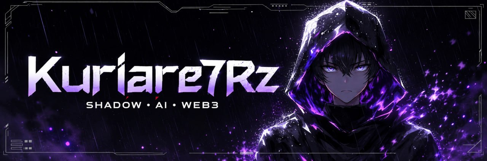

<div align="center">
  

  <br />
  <br />

  <a href="https://x.com/Kuriare7Rz"></a>
  <a href="https://t.me/wisnudlazer"></a>
  <a href="https://discord.gg/4txhucSua2"></a>
</div>

---

## Kuriare7Rz

**Early-phase onchain operator.** New chains, testnets, mint automation, and the
signal tooling that spots things before the timeline does.

> show up early matters.

- **Signal tooling:** X follow-trackers, wallet intel, launch monitoring, Discord alerting
- **Mint ops:** SeaDrop/OpenSea automation, FCFS/allowlist workflows, multi-wallet execution
- **Early-phase ops:** testnet farming, new-chain exploration, protocol recon
- **AI agents:** operator assistants, research helpers, workflow automation

---

## Projects

| Project | What it does |
| --- | --- |
| [rouge — X following tracker](https://github.com/Kuriare7Rz/rouge-x-following-tracker) | Watches target accounts' following lists and fires Discord webhooks on new early-stage follows. Multi-session rotation, drift guard, triple dedupe. Node.js + PM2, zero dependencies. |
| [seadrop-noir-bot](https://github.com/Kuriare7Rz/seadrop-noir-bot) | OpenSea SeaDrop mint bot (Telegram-controlled). Multi-wallet, snipe mode, RPC ranking, proxy rotation, stage-aware scheduled mints — now with `/wl`, a per-wallet eligibility checker (OpenSea + SeaDrop). V2 upgrade of seadrop_nft_minter by @Taqiyaoezanik. |
| [blanc — NFT wallet tracker](https://github.com/Kuriare7Rz/blanc-nft-wallet-tracker) | Real-time Discord alerts when tracked wallets mint, buy, sell, or sweep NFTs — webhook-driven, on-chain classified. |
| [jaune — EVM mint sniper](https://github.com/Kuriare7Rz/jaune-evm-mint-bot) | OpenSea raw-transaction sniper for whitelist/FCFS mints: polls for the released mint tx, then fires a same-nonce gas ladder. |
| [violet-selfie](https://github.com/Kuriare7Rz/violet-selfie) | AI companion skill for my OpenClaw/Hermes agents — after a long day hunting onchain, Violet is here to cheer you up. Powered by 9Router image models. |

---

## Stack

<p align="center">
  
</p>

---

## Current Focus

```txt
> show up early
> ship the tooling
> keep receipts
```

- Running the rouge tracker fleet on live targets
- Mint automation for upcoming drops
- Early-phase intel: new chains, testnets, pre-launch protocols
- AI-assisted ops workflows

---

<div align="center">
  
  <br />
  
</div>
